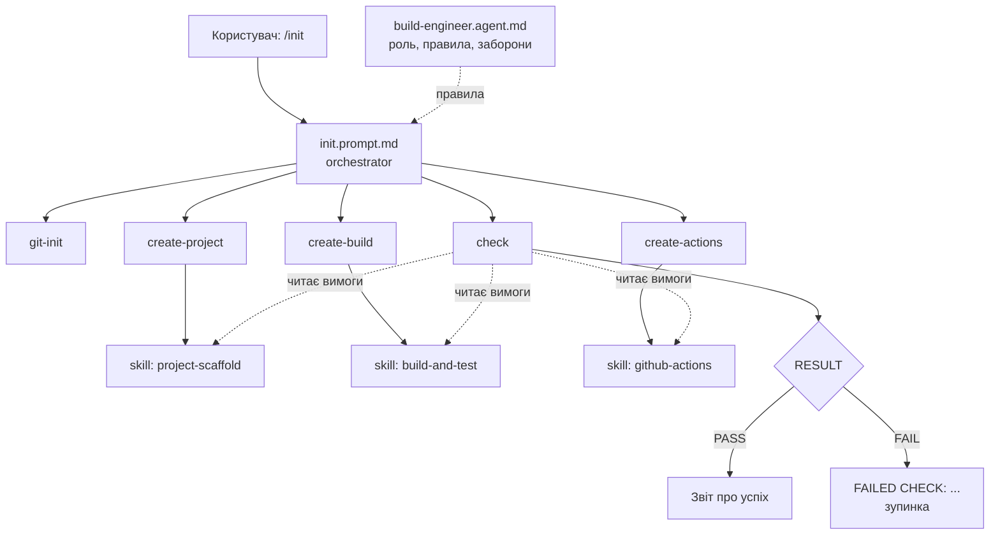

# Архітектура AI-агента `build-engineer`

## 1. Яку проблему вирішує агент

Налаштування навіть мінімального C++ проєкту для трьох ОС — це багато дрібних рішень, у яких легко
помилитися: структура каталогів, CMake, підключення GoogleTest, різниця між single-config (Make/Ninja)
і multi-config (Visual Studio) генераторами, скрипти для bash і cmd, CI-матриця, `.gitignore`.

Агент перетворює ці вимоги на **відтворюваний сценарій**: запуск `/init` у порожній робочій гілці
завжди дає однаковий результат, а команда `/check` доводить, що результат правильний.

## 2. Відповідність файлів формату GitHub Copilot

| Роль у методичці | Файл у репозиторії | Як його бачить Copilot |
|---|---|---|
| Agent manifest | `.github/agents/build-engineer.agent.md` | custom agent, обирається у списку агентів Chat |
| Skill | `.github/skills/<name>/SKILL.md` | agent skill, завантажується за полем `description` |
| Command | `.github/prompts/<name>.prompt.md` | prompt file, запускається як `/<name>` у Chat |
| Orchestrator | `.github/prompts/init.prompt.md` | prompt file, що послідовно викликає інші commands |
| CI | `.github/workflows/ci.yml` | GitHub Actions |

## 3. Схема взаємодії

## 4. Skills

| Skill | Вхід | Вихід | Перевірка |
|---|---|---|---|
| `project-scaffold` | мова = C++, назва = `hello` | `src/`, `tests/`, `.gitignore`, `README.md` | `src/main.cpp` існує, README має потрібні розділи |
| `build-and-test` | назва, стандарт C++17, версія GoogleTest | `CMakeLists.txt`, `tests/test_basic.cpp`, `ci.sh`, `ci.bat` | `ci.sh` проходить, тест `BasicAddition` PASS, `dist/bin/hello` друкує `Hello, World!` |
| `github-actions` | гілки `develop`, `master`; ОС-матриця | `.github/workflows/ci.yml` | YAML валідний, 3 ОС, кроки лише викликають `ci.sh` / `ci.bat` |

## 5. Commands

| Command | Дія | Змінює файли? |
|---|---|---|
| `/git-init` | перевіряє репозиторій і гілку, створює/доповнює `.gitignore`, показує `git status` | так (`.gitignore`) |
| `/create-project` | застосовує skill `project-scaffold` | так |
| `/create-build` | застосовує skill `build-and-test` | так |
| `/create-actions` | застосовує skill `github-actions` | так |
| `/check` | перевіряє структуру, конфігурацію, збірку, тести, YAML, Git-гігієну | **ні** (лише `build/`, `dist/`, які в `.gitignore`) |
| `/init` | orchestrator: запускає 5 команд вище по черзі | через інші команди |

## 6. Дані, що передаються між етапами

| Параметр | Значення | Хто задає → хто використовує |
|---|---|---|
| `project_name` | `hello` | init → усі |
| `language` / `cxx_standard` | C++ / 17 | init → create-project, create-build |
| `build_dir` | `build` | create-build → check, `.gitignore` |
| `dist_dir` | `dist` | create-build → create-actions (артефакт), check |
| `build_type` | `Release` | create-build → ci.sh / ci.bat |
| `test_name` | `HelloTest.BasicAddition` | create-build → check |
| `branches` | `develop`, `master` | init → create-actions |

## 7. Обробка помилок оркестратором

1. **Передумови.** `init` зупиняється одразу, якщо поточна гілка `develop`, `master` або `main`,
   і просить створити `feature/...`.
2. **Fail-fast.** Після кожної command агент перевіряє її результат. При першій помилці виводить
   `FAILED STEP: <command> — <причина>` і **не** запускає наступні кроки.
3. **Успіх лише після check.** `init` не може повідомити про успіх, поки `check` не поверне `RESULT: PASS`.
4. **Ідемпотентність.** Повторний запуск не перезаписує змінені користувачем файли і не дублює
   записи в `.gitignore` чи CI.

## 8. Ключові технічні рішення

| Рішення | Чому |
|---|---|
| Логіка `add()` в окремій бібліотеці `hello_core`, `main.cpp` лише друкує | тест лінкується з бібліотекою, а не з `main()` |
| GoogleTest через `FetchContent` (фіксована версія) | не треба встановлювати gtest окремо на кожній ОС |
| `gtest_force_shared_crt ON` | без цього на Windows/MSVC конфлікт runtime-бібліотек |
| Скрізь `--config Release` і `ctest -C Release` | Visual Studio — multi-config генератор, без цього тести не знаходяться |
| `cmake --install` у `dist/` | однаковий шлях `dist/bin/hello` на всіх ОС для артефакту CI |
| `ci.sh` / `ci.bat` приймають етап (`configure`, `build`, `test`, `run`) | у CI видно окремі кроки, але вся логіка лишається у скриптах |
